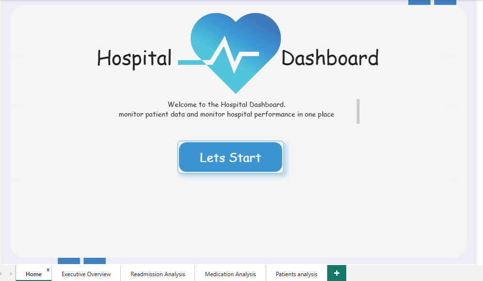
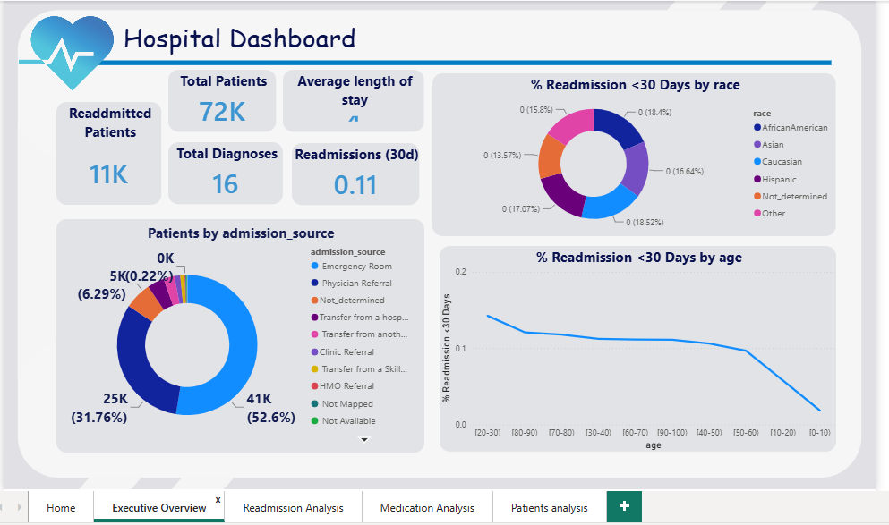
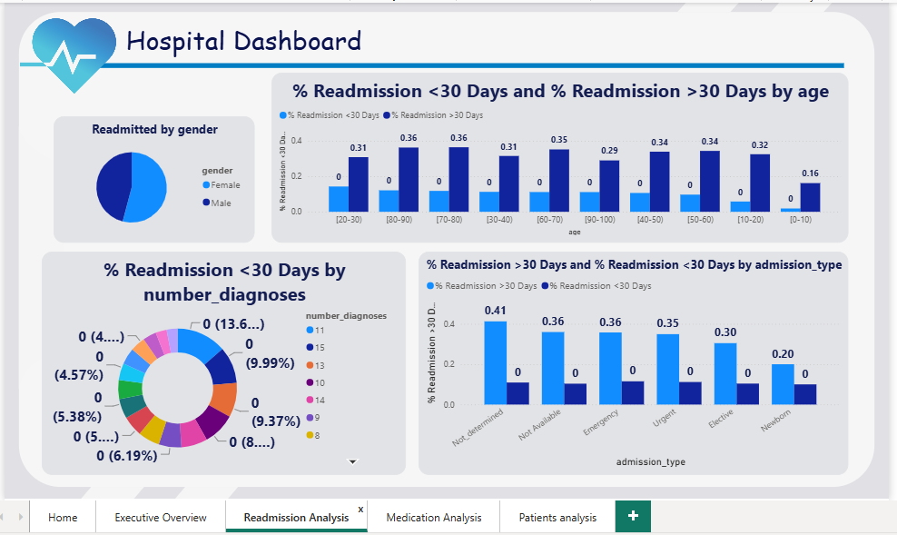
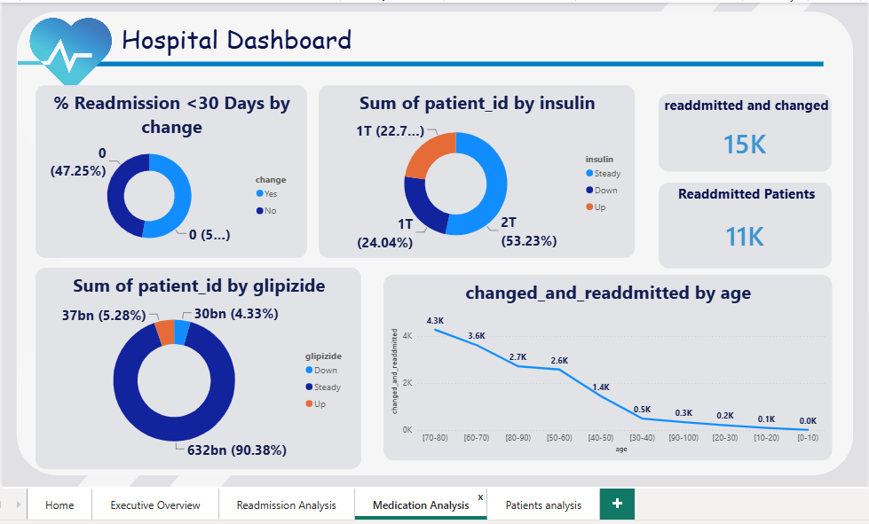
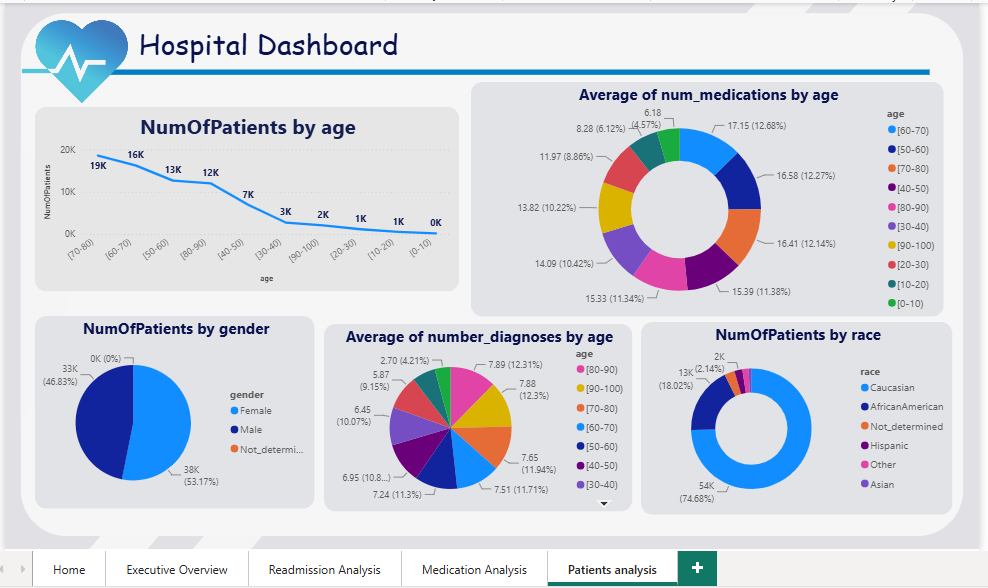

# 🏥 Healthcare Analytics Dashboard | Power BI

An interactive Power BI dashboard to monitor patient statistics and hospital performance, with a focus on hospital readmission analysis.

## 🎯 Business Questions
- What is the overall 30-day readmission rate, and how does it vary by age, gender, and race?
- Which admission types and sources are linked to higher readmission?
- Do medication changes affect readmission outcomes?

## 📊 Dashboard Pages
- **Executive Overview:** KPIs (readmission rate, patients, diagnoses) with breakdowns by race, age, and admission source
- **Readmission Analysis:** Readmission <30 and >30 days by age, admission type, and number of diagnoses
- **Medication Analysis:** Insulin and glipizide usage, medication changes, and readmission
- **Patients Analysis:** Patient demographics by age, race, gender, medications, and diagnoses

## 🖼️ Dashboard Preview
| Executive Overview | Readmission Analysis |
|----|----|
|  |  |

| Medication Analysis | Patients Analysis |
|----|----|
|  |  |

## 🔍 Key Insights
- The overall 30-day readmission rate is about 11% (≈11K of 72K patients), while readmissions after 30 days are much higher at roughly 30–36% across most age groups.
- Most patients are aged 50–90, with the 70–80 group the largest (≈19K patients).
- The 30-day readmission rate is highest among patients aged 20–30 (~14%) and stays around 11–12% for older adults, but drops sharply for children (~2% for ages 0–10).
- The Emergency Room is the main admission source (52.6% of patients), followed by Physician Referral (31.8%).
- Readmissions after 30 days are highest for "Not determined" (41%), Emergency (36%), and Urgent (35%) admissions, and lowest for Newborn (20%) and Elective (30%).
- Patient complexity rises with age: average diagnoses per patient increase from ~2.7 (youngest group) to ~7.9 (ages 80–90), and medication use peaks at ages 60–70 (~17 medications).
- Insulin dosage was kept steady for about 53% of patients (down ~24%, up ~23%), and glipizide was steady for about 90%.
- The patient base is 53% female and 47% male, and about 75% Caucasian.
- 30-day readmission rates are nearly identical across racial groups (about 14–19% share each), so race does not appear to be a strong driver.

## 🛠️ Tools Used
Power BI, DAX.

## 📂 Dataset
Source: Kaggle.

## 📬 Contact
Menna Mohammad | https://www.linkedin.com/in/mennatullah-mohammad-data-analyst/ | mennatullahabdussamad1@gmail.com.
